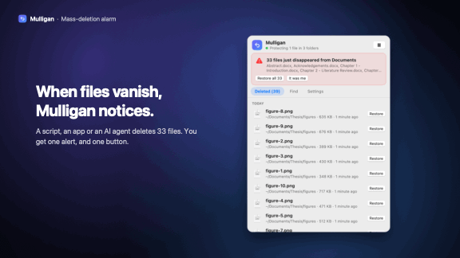
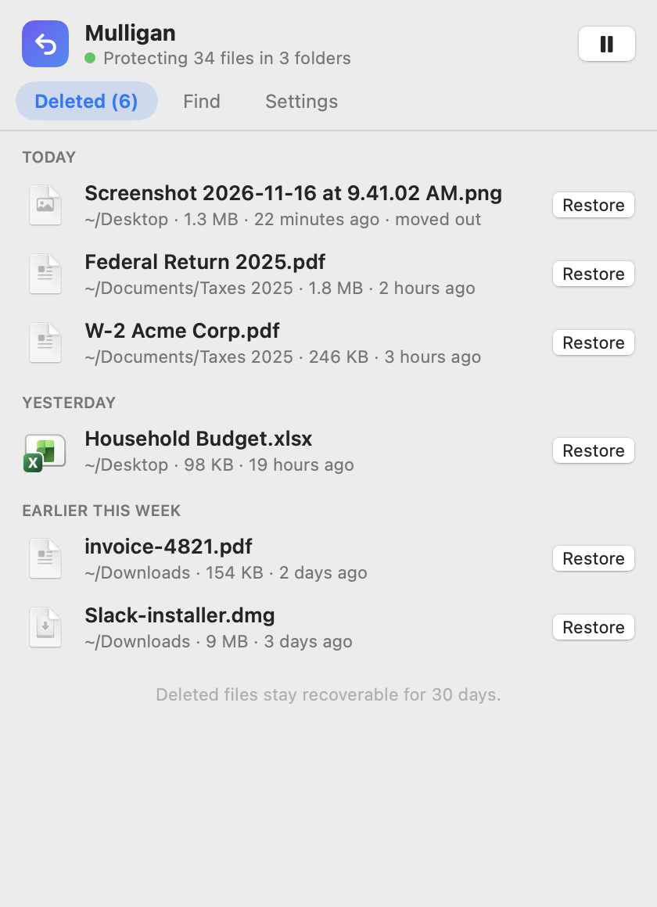
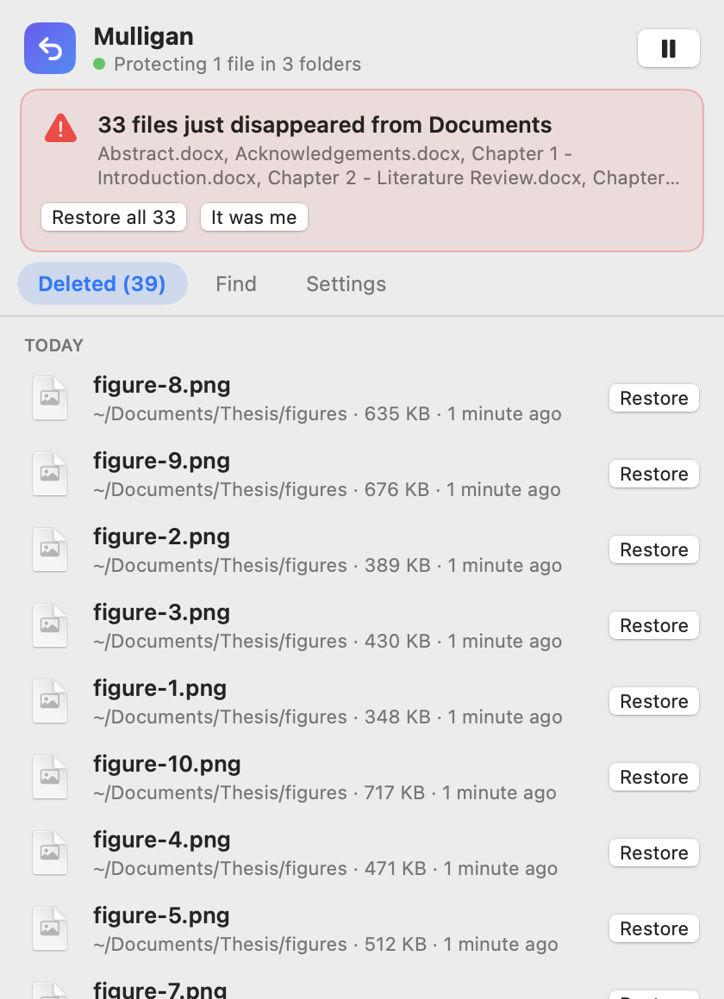
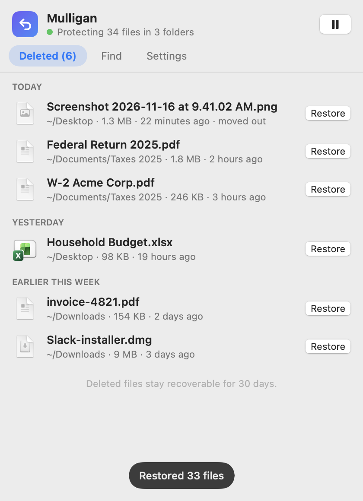
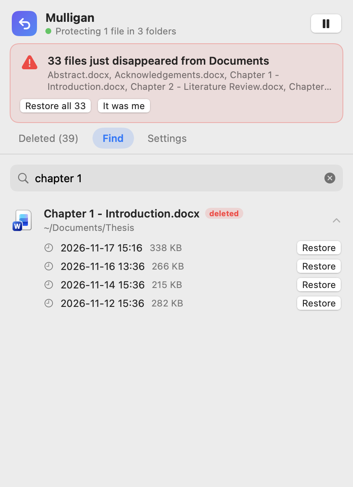
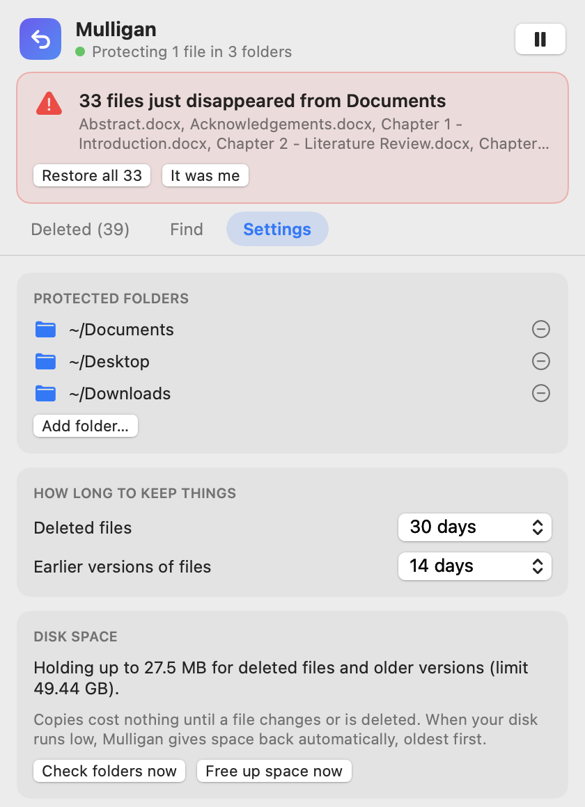
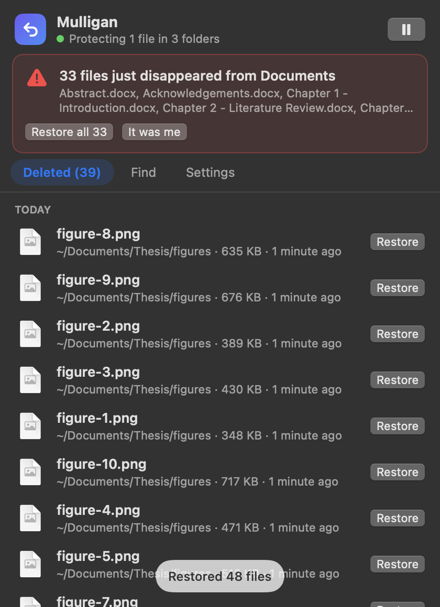
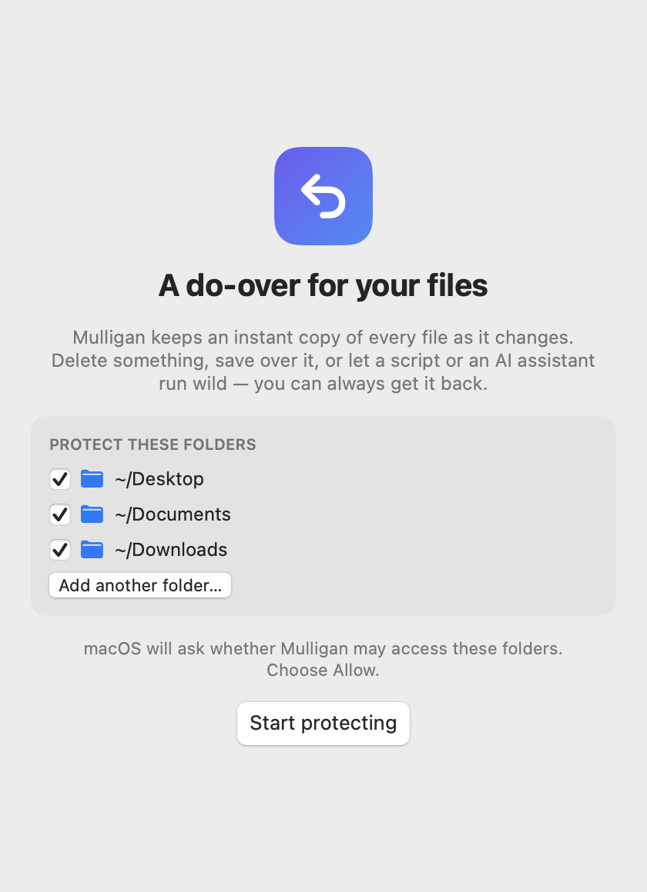

<div align="center">


# Mulligan — Undo Deleted & Overwritten Files on Mac

### Recover files deleted with `rm` · Get files back after emptying the Trash · Undo a save-over · Undo what a script or AI agent deleted · Version history for every file

**Mulligan is a free, open-source Mac menu bar app that keeps an instant APFS copy of every file you care about, so anything deleted or overwritten is one click away. No backup disk needed.**

[](https://github.com/PriyanshuGeTRekT/mulligan-undo-deleted-files-mac/releases/latest)
[](https://github.com/PriyanshuGeTRekT/mulligan-undo-deleted-files-mac/releases)
[](https://github.com/PriyanshuGeTRekT/mulligan-undo-deleted-files-mac/stargazers)
[](https://github.com/PriyanshuGeTRekT/mulligan-undo-deleted-files-mac/forks)
[](https://hits.sh/github.com/PriyanshuGeTRekT/mulligan-undo-deleted-files-mac/)
[](https://github.com/PriyanshuGeTRekT/mulligan-undo-deleted-files-mac/actions/workflows/build.yml)

[](https://github.com/PriyanshuGeTRekT/mulligan-undo-deleted-files-mac/issues)
[](https://github.com/PriyanshuGeTRekT/mulligan-undo-deleted-files-mac/commits/main)
[](LICENSE)


[](#option-2--install-with-homebrew)

[**⬇️ Download Mulligan**](https://github.com/PriyanshuGeTRekT/mulligan-undo-deleted-files-mac/releases/latest/download/Mulligan.zip) · [Website](https://priyanshugetrekt.github.io/mulligan-undo-deleted-files-mac/) · [Features](#features) · [Screenshots](#screenshots) · [Install](#installation) · [Command line](#command-line) · [FAQ](#faq)

<br>



</div>

---

## What is Mulligan?

On a Mac, only the Finder's Trash can be undone. Everything else is permanent:

- a file deleted in **Terminal with `rm`**, or with **Delete Immediately**
- an **emptied Trash**
- a document **saved over** with the wrong content
- a **script** that goes wrong, or an **AI coding agent** that "cleans up" a folder
- an app that quietly **overwrites or deletes** its own files

Time Machine only helps if a backup disk happens to be plugged in, and it saves at most once an hour. Apple's built-in "versions" exist only inside a few document apps.

**Mulligan** closes that gap. It keeps an instant copy of every file in the folders you protect, each time the file changes. Anything deleted or overwritten can be brought back, byte for byte, in one click or one command. And when many files vanish at once, which is what a runaway script or agent looks like, it raises **one alarm with a Restore all button**.

```bash
mulligan run -- ./cleanup.sh     # afterwards: "it deleted 212 files, modified 9"
mulligan undo-run last           # ...and puts all of it back
```

| | |
|---|---|
| ⚡️ **Instant** | APFS clones copy a 1 GB file in 0.00 s and cost no space until the file changes. |
| 🤖 **Automatic** | Watches Desktop, Documents and Downloads from the moment you install it. |
| 🔒 **Private** | Everything stays on your Mac. No account, no cloud, no network requests at all. |
| 🪶 **Light** | 60,000 files protected in 11 seconds using 46 MB. Re-scans take under a second. |
| 💸 **Free & open source** | MIT licensed. No trial, no subscription, no "Pro" tier. |

## Table of contents

- [What is Mulligan?](#what-is-mulligan)
- [Features](#features)
- [Screenshots](#screenshots)
- [Requirements](#requirements)
- [Installation](#installation)
- [Command line](#command-line)
- [How it works](#how-it-works)
- [Privacy and safety](#privacy-and-safety)
- [Known limitations](#known-limitations)
- [FAQ](#faq)
- [Roadmap](#roadmap)
- [Contributing](#contributing)
- [License](#license)

## Features

### 🗑️ Recently deleted, for every file

- Every deleted file in your protected folders, grouped by **today, yesterday and earlier**, with a **Restore** button.
- Restores **byte for byte**, with the original modification date.
- **Never overwrites:** if something already lives at the old path, the copy lands next to it as `name (restored 2026-11-17 10.32).ext`.
- Files moved into the Trash show as **"moved out"**, not as lost, and emptying the Trash afterwards doesn't matter.
- Recoverable for **30 days** by default.

### 🚨 Mass-deletion alarm

- When **25 or more files** really disappear within a minute, Mulligan raises **one alert**, not one per file, with **Restore all** and **It was me**.
- **Renames and moves are recognised** (files are matched by inode), so reorganising a folder never triggers it.
- Short-lived temp files (gone within 5 seconds) don't count.
- A macOS notification, even when the menu is closed.

### 🕘 Version history and search

- **Every saved version of every file:** everything for 24 hours, hourly for a week, daily after that.
- **Search** live and deleted files together, by name or path.
- **Restore a whole folder as it was** at any time, e.g. "yesterday at 18:00".

### 🤖 Undo a command, a script or an AI agent

- Wrap anything in **`mulligan run --`**: a shell script, `claude`, `codex`, a migration, a build.
- Afterwards it reports exactly what the command **deleted and modified** in your protected folders.
- **`mulligan undo-run`** puts all of it back in one go.
- **`mulligan checkpoint "before refactor"`** sets a named point you can return to.

### 💾 Costs almost no disk space

- **APFS clones** share disk blocks with your files. Only what changes or gets deleted takes space.
- A **space budget** (10% of the disk, at most 50 GB) and **automatic release when free space drops below 8 GB**, oldest first.
- The vault is **excluded from Time Machine and Spotlight**.
- Skips `node_modules`, caches, build folders, app and photo-library packages, files over 20 GB, and iCloud placeholders.

## Screenshots

| Recently deleted | Mass-deletion alarm | Restored |
|:---:|:---:|:---:|
|  |  |  |

| Version history and search | Settings and disk space | Dark mode |
|:---:|:---:|:---:|
|  |  |  |

| First launch |
|:---:|
|  |

<sub>Screenshots and the demo are rendered by the app itself from a demo vault, so no personal information appears in them.</sub>

## Requirements

- **macOS 14 Sonoma or later** (built and tested on macOS 27).
- **Apple silicon** Mac (M1 or newer).
- Folders on an **APFS** volume (the default for every modern Mac disk). Other volumes fall back to real copies.
- To build from source: the Xcode Command Line Tools. Full Xcode is not needed.

## Installation

### Option 1 — Download the app

1. Download **[Mulligan.zip](https://github.com/PriyanshuGeTRekT/mulligan-undo-deleted-files-mac/releases/latest/download/Mulligan.zip)** from the latest release.
2. Unzip it and drag **Mulligan.app** into your **Applications** folder.
3. Open Mulligan. Because the app isn't notarized by Apple, macOS blocks the first launch:
   - open **System Settings › Privacy & Security**, scroll down and click **Open Anyway** next to Mulligan, or
   - run this once in Terminal:
     ```bash
     xattr -dr com.apple.quarantine /Applications/Mulligan.app
     ```
4. Choose which folders to protect (Desktop, Documents and Downloads by default) and click **Allow** when macOS asks for access. The undo-arrow icon appears in your menu bar.

### Option 2 — Install with Homebrew

```bash
brew tap priyanshugetrekt/mulligan https://github.com/PriyanshuGeTRekT/mulligan-undo-deleted-files-mac
```

```bash
brew install --cask priyanshugetrekt/mulligan/mulligan
```

The cask also links the `mulligan` command into your path. The first launch still needs **Open Anyway** (step 3 above).

### Option 3 — Build from source

1. Install the Command Line Tools if you don't have them:
   ```bash
   xcode-select --install
   ```
2. Clone the repository:
   ```bash
   git clone https://github.com/PriyanshuGeTRekT/mulligan-undo-deleted-files-mac.git
   ```
3. Build the app:
   ```bash
   cd mulligan-undo-deleted-files-mac && ./build.sh
   ```
4. Copy it into Applications and open it:
   ```bash
   ditto dist/Mulligan.app /Applications/Mulligan.app && open /Applications/Mulligan.app
   ```

To check everything on your Mac, run the built-in self-test:

```bash
dist/Mulligan.app/Contents/MacOS/MulliganBar --selftest
```

Prefer the terminal only? `mulligan install-agent` runs the watcher at login without the menu-bar app.

### Uninstalling Mulligan

Choose **Quit** in the menu, run `mulligan uninstall-agent` if you installed the agent, then move `/Applications/Mulligan.app` and `~/Library/Application Support/Mulligan` to the Trash. Deleting that folder releases all the space the saved copies held.

## Command line

The `mulligan` command is inside the app at `Mulligan.app/Contents/Resources/bin/mulligan` (Homebrew links it for you).

```
mulligan status                       what is protected, space held, whether the watcher runs
mulligan deleted [text] [--since 2h]  recently deleted files        (#ID is what you restore by)
mulligan find <text>                  search live and deleted files by path
mulligan history <path>               every saved version of a file
mulligan restore <path|#id> [--at 2h] [--version N] [--to DIR] [--replace]
mulligan restore-tree <folder> --deleted [--since 10m]    bring back everything deleted from a folder
mulligan restore-tree <folder> --at "yesterday 18:00"      the folder as it was then
mulligan run [--label L] -- <command…>        snapshot, run, report what changed
mulligan undo-run [id|last]           restore what that run deleted or rewrote
mulligan checkpoint "before refactor" a named point to return to with undo-run
mulligan forget <path|#id>            erase from the vault now (privacy)
mulligan doctor                       checks: APFS? same volume? watcher up? Time Machine?
```

Most commands accept `--json` for scripts. Restoring never overwrites unless you pass `--replace`, and even then the file you replaced is itself kept as a version.

## How it works

- **Watcher:** FSEvents (file-level) → a short debounce → an APFS clone of each changed file into `~/Library/Application Support/Mulligan/Vault`, indexed in SQLite.
- **Baseline and reconcile:** at start-up it walks the protected folders, saves what's new or changed and marks what has gone. Dropped or coalesced events are handled by a subtree rescan.
- **Renames aren't deletions:** files are matched by inode, so moving a file or a whole folder keeps its history and doesn't trigger the alarm.
- **Retention:** everything for 24 h, then hourly for a week, then daily; deleted files are kept 30 days; big files keep fewer versions; a space budget of 10% of the disk (at most 50 GB).

Measured on an M-series Mac:

| | |
|---|---|
| Clone a 1 GB file | 0.00 s, 0 MB |
| Protect 60,000 files for the first time | 11 s, 46 MB |
| Re-scan 60,000 unchanged files | 0.6 s |

## Privacy and safety

- **No network requests at all.** No analytics, no telemetry, no account, no cloud.
- Mulligan **only writes inside its own folder**, except when you restore a file, and a restore never overwrites unless you ask.
- The vault is readable only by your user account and is excluded from Time Machine and Spotlight.
- **Pause** stops saving during sensitive work; `mulligan forget` erases a file's copies immediately.
- The source is small and readable. Check it yourself.

## Known limitations

- **It is not a backup.** The copies live on the same disk, so a dead or stolen Mac takes them along. Keep Time Machine or a cloud backup too; Mulligan covers the everyday accidents those are slow at. `mulligan doctor` and the app warn you when no backup disk is set up.
- **Deleted files keep their disk space** until retention releases them. The Settings tab shows how much is held; **Free up space now** and `mulligan forget` release it immediately.
- **Gaps in time:** a file created and deleted within about 1–2 seconds is never seen. Rapid saves are versioned at most every 20 seconds (files over 10 MB every 5 minutes, over 1 GB every 30 minutes). The most recent saved version always survives.
- **Other disks:** folders on non-APFS volumes can't be cloned, so Mulligan makes real copies (up to 256 MB per file).
- **Not notarized.** The download needs the one-time "Open Anyway" step. Building from source avoids it.
- **Permissions:** Desktop, Documents, Downloads and removable volumes each trigger a one-time "allow access" prompt; other folders may need Full Disk Access.

## FAQ

### How do I recover a file I deleted with rm on Mac?
`rm` skips the Trash, so without a copy the file is gone. If Mulligan was protecting the folder, open Mulligan's **Deleted** tab and click **Restore**, or run `mulligan restore` with the file's path.

### Can I get files back after emptying the Trash on Mac?
Yes, if they were in a folder Mulligan protects. Mulligan kept a copy when the file was created or changed, so emptying the Trash doesn't matter.

### How do I undo what an AI coding agent deleted?
Run the agent through `mulligan run -- your-command` (for example `mulligan run -- claude`). Afterwards Mulligan lists what was deleted and changed, and `mulligan undo-run last` puts it all back. The menu-bar app also alerts you when many files vanish at once, even without `run`.

### How do I get back an earlier version of a file I saved over?
Open the **Find** tab, search for the file, and pick the version you want. Or run `mulligan history <path>` and `mulligan restore <path> --version N`.

### Is Mulligan a backup? Do I still need Time Machine?
Mulligan is not a backup: the copies are on the same disk. Keep Time Machine or a cloud backup for a dead or stolen Mac. Mulligan covers the everyday accidents (a file deleted or overwritten an hour ago) that backups are slow or too coarse for.

### Does Mulligan use a lot of disk space?
No. APFS clones cost nothing until a file changes or is deleted. Deleted files keep their space until they expire (30 days by default) or until your disk gets low, when Mulligan gives the oldest back first.

### Why does macOS say Mulligan cannot be opened?
Mulligan is not notarized by Apple, so macOS blocks the first launch. Open **System Settings › Privacy & Security**, scroll down and click **Open Anyway** next to Mulligan. You only need to do this once.

### Does Mulligan work on Intel Macs?
Release builds are for Apple silicon. It may build and run on Intel Macs from source, but that isn't tested.

### Is Mulligan free? Is it safe?
Yes. It is free and open source under the MIT License. It makes no network requests, has no account, and only ever writes inside its own folder, except when you restore a file.

## Roadmap

- Notarized builds
- Protecting folders on external drives by default
- A Finder extension: right-click › "Show versions"
- More languages

Ideas and bug reports are welcome in [Issues](https://github.com/PriyanshuGeTRekT/mulligan-undo-deleted-files-mac/issues). See the [changelog](CHANGELOG.md) for what's new in each release.

## Contributing

See [CONTRIBUTING.md](CONTRIBUTING.md). In short: fork, build with `./build.sh`, run `./scripts/test.sh` and `--selftest` before and after your change, and open a pull request. Security issues: see [SECURITY.md](SECURITY.md).

```bash
./scripts/test.sh                              # unit tests: engine, retention, restore, runs, live watcher
./scripts/smoke.sh .build/debug/mulligan       # sandboxed end-to-end run of the CLI, including a real rm -rf
dist/Mulligan.app/Contents/MacOS/MulliganBar --render /tmp/screens   # renders every screen from a demo vault
```

Project layout:

```
Sources/
├── MulliganCore/   Engine (no UI): watcher, vault, SQLite index, retention, restore, runs
├── mulligan/       The command-line tool
└── MulliganBar/    Menu-bar app, self-test and screenshot renderer
Tests/              Unit tests (Swift Testing)
docs/               Website (GitHub Pages), screenshots, demo
Casks/              Homebrew cask
```

## Star history

If Mulligan ever saves your work, a ⭐ star helps other Mac users find it.

[](https://star-history.com/#PriyanshuGeTRekT/mulligan-undo-deleted-files-mac&Date)

## License

[MIT](LICENSE) © 2026 [Priyanshu Yadav](https://github.com/PriyanshuGeTRekT)

<div align="center">
<sub><b>Mulligan</b> — free undo for Mac files: recover deleted files, recover files deleted with rm, recover files after emptying the Trash, undo save-over, file version history, undo what an AI coding agent or script deleted, mass-deletion alert, APFS snapshots and clones, Time Machine alternative for everyday accidents on Apple silicon Macs.</sub>
</div>
